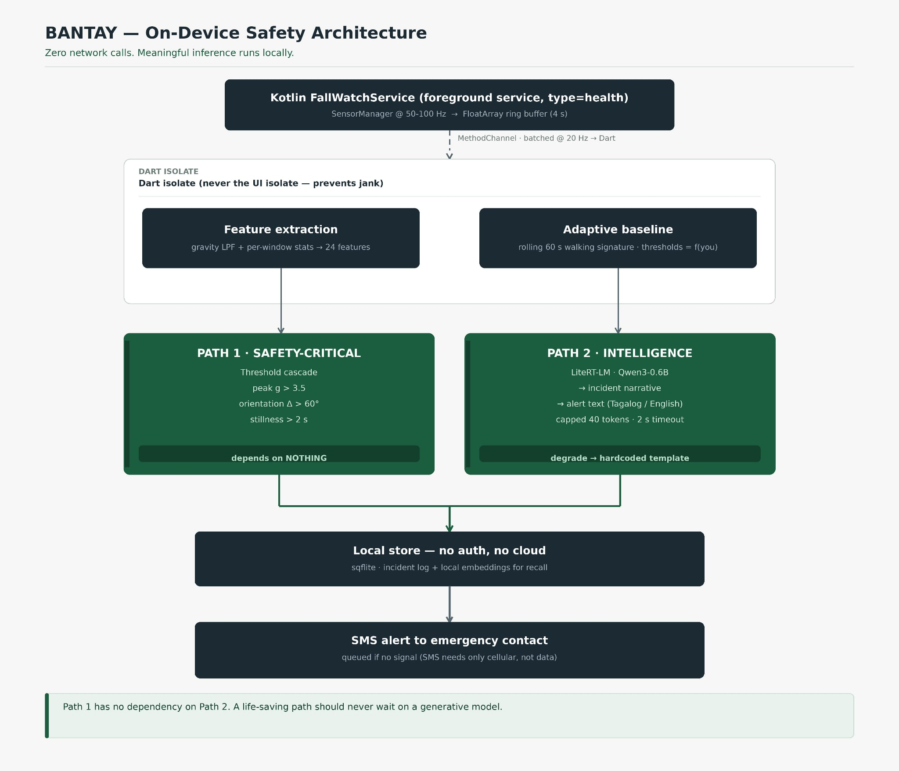

# BANTAY — Software Architecture

Deep dive on system design. For the build schedule, detector math, LLM prompt,
and risk table, see [SPEC.md](SPEC.md).



Source: `system-architecture.jpeg`

---

## 1. Design principles

Three rules drove every structural decision.

**1. The safety-critical path depends on nothing.**
No model, no network, no storage, no allocation-heavy work. If the LLM process
dies mid-run, Path 1 still fires. This is why the threshold cascade exists
alongside the MLP rather than being replaced by it.

**2. Never block on generation in the trigger path.**
The countdown starts the moment the detector fires. Path 2 runs concurrently
and may or may not finish before the user acts. It enriches the message; it
never gates it.

**3. Degrade, don't fail.**
Every downstream consumer gets a usable value even when its upstream produced
nothing. LLM times out → template string. No signal → queued SMS. No
gyroscope → accelerometer-only detection.

---

## 2. Module map

| Module | Language | Owner | Responsibility |
|--------|----------|-------|----------------|
| `FallWatchService` | Kotlin | B | Foreground service, `SensorManager` listener, ring buffer |
| `SensorChannel` | Kotlin | B | `MethodChannel`, batches events at 20Hz to Dart |
| `FeatureExtractor` | Dart | A | Gravity LPF, windowing, 24-feature vector |
| `BaselineModel` | Dart | A/C | Rolling walking signature, adaptive thresholds |
| `ThresholdDetector` | Dart | A | Path 1 cascade, emits `ImpactEvent` |
| `MlpDetector` | Dart | C | Path 1b, loads JSON weights, pure-Dart forward pass |
| `AlertComposer` | Dart | A | Fills LLM prompt, owns the hardcoded fallback |
| `LlmEngine` | Dart | A | LiteRT-LM session lifecycle, timeout, token cap |
| `IncidentStore` | Dart | A | sqflite, incident log, local embeddings |
| `SmsSender` | Kotlin | B | `SmsManager`, outbox queue when no signal |
| `EvalHarness` | Python | C | Synthetic generation, training, confusion matrix |

### Dependency rule

Nothing below `LlmEngine` may import it. `AlertComposer` is the only module
that knows the LLM exists, and it must produce valid output when the engine is
absent. Enforce this with a single interface and one fake implementation in
tests.

---

## 3. Threading model

Three execution contexts. Getting this wrong causes jank at 50Hz, which is
the first thing a judge sees.

| Context | Work | Notes |
|---------|------|-------|
| **Kotlin service thread** (`HandlerThread`) | `SensorManager` listener, ring buffer writes | Must not touch UI |
| **Dart background isolate** | Feature extraction, both detectors, baseline | **Not** the UI isolate |
| **Main isolate** | Widget tree, countdown, rendering | No compute |

```
SensorManager @ 50-100Hz (service thread)
      ↓  FloatArray ring buffer, 4s capacity
MethodChannel, batched @ 20Hz          ← batching is mandatory;
      ↓                                 unbatched is 50-100 platform hops/sec
Dart background isolate
      ↓  24 features per 1s window (50% overlap)
ThresholdDetector ─┬─→ ImpactEvent ──→ main isolate (countdown starts)
MlpDetector ────────┘
                    └─→ (concurrent) → LlmEngine → AlertComposer
```

**Why batch at 20Hz:** one platform hop per sensor sample is 50–100
channel traversals per second, which dominates the frame budget. Batch a
50-sample frame and send at 20Hz. Detection latency cost is ~50ms, inside the
sub-100ms target.

**Why 4s buffer:** 2s detection window at 50% overlap needs 1s of history,
plus the pre-impact baseline the cascade reads for orientation comparison.
4s gives headroom without meaningful memory cost (~4KB of floats).

---

## 4. Detection state machine

```
IDLE
  │  window closed, features computed
  ▼
ARMED ──── baseline invalid ──▶ CALIBRATING
  │                                    │ 20s of walking captured
  │                                    ▼
  │                                 ARMED
  │  cascade condition 1 (peak g > 3.5)
  ▼
PRECURSOR ──── condition 2 fails ──▶ back to ARMED (rejected)
  │ condition 2 (Δorientation > 60°)
  ▼
PRECURSOR ──── condition 3 fails ──▶ back to ARMED (rejected)
  │ condition 3 (stillness ≥ 2s)
  ▼
IMPACT ────── condition 4 (test flag) ──▶ suppressed
  │                                        (calibration window)
  ├──▶ emit ImpactEvent ──▶ countdown (Path 1, immediate)
  │                      └─▶ LlmEngine (Path 2, concurrent)
  ▼
POST_IMPACT ── user OK ──▶ ARMED
  │            timeout ───▶ SmsSender ──▶ ARMED
  ▼
ARCHIVED ──── incident written to store
```

Conditions 2 and 3 are what separate a dropped phone from a fall. A drop
trips condition 1 and usually 2, then bounces — it doesn't sit still for 2s.
Condition 4 exists so a judge's "let me test it" tap doesn't page a real
person.

**Both detectors feed the same state machine.** The MLP can advance the state;
the cascade can advance it. Whichever fires first wins. Neither can veto the
other into silence, because a false negative is more costly than a false
positive at this stage.

---

## 5. Path 1 — threshold cascade

Ordered cheapest-first, so a typical shake never reaches the orientation math.

| # | Condition | Threshold | Rationale |
|---|-----------|-----------|-----------|
| 1 | Vector magnitude peak | > 3.5 g | Free-fall then impact. Below this is a bump |
| 2 | Low-passed gravity orientation delta | > 60° | Device rotated during impact |
| 3 | Post-impact stillness | ≥ 2s, < 0.15 g variance | Falls end in stillness. Drops bounce |
| 4 | Test/calibration flag window | 8s suppression | Don't page someone during a demo tap |

Gravity estimate comes from a first-order IIR low-pass (~20 lines) separating
the ~1g gravity vector from the high-frequency acceleration signal.

**Honest number:** published threshold algorithms reach ~57% sensitivity on
*real human falls* — modest. They fire reliably on a dropped phone, which is
what a stage demo requires. Don't overclaim in the pitch.

---

## 6. Path 1b — MLP

```
24 → 16 (ReLU) → 2 (softmax)
```

~434 parameters. Weights ship as a JSON asset, forward pass in pure Dart
against a `Float64List`. No TFLite, no ONNX, no native ML dependency.

**Budget:** ~434 MACs × 100 windows/sec = 43,400 MAC/s ≈ **0.002% of one
core**. Arithmetic is free here. The real costs are feature extraction and
isolate contention.

Use `Float64List`, not `List<double>` — boxing would dominate at this rate.

Role is to **improve on** the cascade (fewer false positives on ADL, catch
low-g falls the threshold misses), not to replace it. Ship whichever validates
better on the held-out set.

---

## 7. Adaptive baseline (the personalization layer)

The concept: thresholds relative to *your* gait, not a population average.
Scoped honestly — this is adaptive thresholds from a rolling signature, **not**
on-device fine-tuning. The judge-facing argument is identical, and this version
is buildable in 24 hours.

- Rolling 60s window of walking-state features
- Derives per-user `g_thresh`, `Δorientation_thresh`, stillness duration
- Anomalies below the user's own baseline raise sensitivity rather than firing

Subtle and honest limitation: a real fall *is* an anomaly relative to baseline.
The cascade catches gross deviations; the baseline tunes the margin. It does
not predict injury. Say that if a judge asks.

---

## 8. Path 2 — LLM

LiteRT-LM over `dart:ffi` via `flutter_edge_ai_litertlm`. Model
`litert-community/Qwen3-0.6B` (mixed INT4 variant: 474.61 MiB, CPU backend, multilingual — that
multilingual coverage is what buys the Tagalog alert).

The current Flutter package bundles the LiteRT-LM native runtime. Host app
requires Android API 30+ and arm64. See [Path 2 integration](bantay_llm/README.md).

### Session lifecycle

```
first launch ──▶ sideload .litertlm to app-readable path
             ──▶ FlutterEdgeAi.initialize() and installModel().fromFile()
             ──▶ getActiveModel(maxTokens: 2048); pre-open session

every impact ──▶ openSession(maxOutputTokens: 40, enableThinking: false)
              ──▶ addQueryChunk(prompt) ──▶ getResponse()
              ──▶ hard 2s wall-clock timeout
              ──▶ on timeout/failure/empty ──▶ hardcoded template
```

### Non-negotiables

- `maxOutputTokens: 40` (`maxTokens` is the context window)
- 2s hard timeout
- Hardcoded bilingual fallback string, unedited
- Fully functional with the LLM absent

A 0.6B model will not write a freeform emergency message reliably. Documented
failure mode is a team burning a sprint on four prompt rewrites. Hence: filled
template, never a blank page. See SPEC.md §7 for the prompt.

**Contingency:** `net.ladenthin:llama-android` (runs x86_64, so emulator too)
if LiteRT-LM won't load. Decided at hour 2, not hour 20.

---

## 9. Data model

### sqflite — `incidents`

| Column | Type | Notes |
|--------|------|-------|
| `id` | INTEGER PK | |
| `ts` | INTEGER | epoch ms |
| `peak_g` | REAL | |
| `delta_orientation` | REAL | degrees |
| `pre_context` | TEXT | `walking` / `still` / `running` / `unknown` |
| `motion_summary` | TEXT | `moved` / `no_movement_{n}s` |
| `llm_narrative` | TEXT | nullable |
| `llm_used` | INTEGER | 0 = fallback template fired |
| `outcome` | TEXT | `sent` / `cancelled` / `suppressed` |
| `location` | REAL | lat/lng, no reverse geocode |

`llm_used` exists so the demo can prove the fallback path was exercised.

### sqflite — `embeddings`

| Column | Type |
|--------|------|
| `incident_id` | INTEGER FK |
| `vector` | BLOB |

Powers screen 5's "what happened last Tuesday?" — local embeddings, local
recall, works with the radio off.

### SMS outbox

| Column | Type | Notes |
|--------|------|-------|
| `incident_id` | INTEGER FK | |
| `to_number` | TEXT | |
| `body` | TEXT | final text, LLM or fallback |
| `state` | TEXT | `queued` / `sent` / `failed` |
| `attempts` | INTEGER | retry on signal return |

**Why SMS survives a dead zone:** SMS needs only a cellular signal, not data.
In a typhoon, data is frequently dead while SMS still routes. That asymmetry
is the graceful-degradation story, and it's real.

---

## 10. Permissions rationale

```xml
<uses-permission android:name="android.permission.FOREGROUND_SERVICE" />
<uses-permission android:name="android.permission.FOREGROUND_SERVICE_HEALTH" />
<uses-permission android:name="android.permission.HIGH_SAMPLING_RATE_SENSORS" />
<uses-permission android:name="android.permission.POST_NOTIFICATIONS" />
<uses-permission android:name="android.permission.WAKE_LOCK" />
<uses-permission android:name="android.permission.SEND_SMS" />
<uses-permission android:name="android.permission.ACCESS_COARSE_LOCATION" />
```

| Permission | Why | Trap |
|------------|-----|------|
| `FOREGROUND_SERVICE_HEALTH` | Required type for the monitoring service | Android 14+: undeclared type → `MissingForegroundServiceTypeException` at `startForeground()` |
| `HIGH_SAMPLING_RATE_SENSORS` | Sensor access without a runtime dialog | Must also declare `foregroundServiceType` in `<service>` |
| `POST_NOTIFICATIONS` | The persistent FGS notification | Runtime dialog, API 33+ |
| `WAKE_LOCK` | Sampling with screen off | Battery cost — see §13 |

**Do NOT add `BODY_SENSORS`.** It's a while-in-use permission. Once
backgrounded, the health FGS throws `SecurityException`, and the workaround
(`BODY_SENSORS_BACKGROUND`) needs an installer allowlist a hackathon can't
obtain. `HIGH_SAMPLING_RATE_SENSORS` is install-time, no dialog, no allowlist.
Single highest-leverage permission decision in the build.

### Version constraints

- **Android 14 (API 34):** FGS type must be declared *and* match. Mismatch →
  `IllegalArgumentException`. Missing per-type permission → `SecurityException`.
- **Android 12+:** cannot start a foreground service from background. Start it
  from a visible activity in the setup flow.
- **Android 15:** `BOOT_COMPLETED` can't launch `dataSync`/`camera`/
  `microphone` FGS types. `health` isn't on that list, so auto-restart-on-boot
  should work — **test it, don't assume it.**

---

## 11. Failure modes

| Failure | Behavior | Recovery |
|---------|----------|----------|
| LiteRT-LM won't load | Path 2 disabled, flag set | Template path; UI shows "offline text mode" |
| LLM exceeds 2s | Abort generation | Template string, `llm_used = 0` |
| LLM returns garbage | Length/shape check | Template string, logged |
| No gyroscope registered | Accelerometer-only features | Logged as known limitation |
| Battery optimization kills service | Sampling stops | Demo runs screen-on foregrounded; prompt user |
| No cellular signal | SMS queued | Retry on signal return via outbox |
| sqflite write fails | Incident in memory only | Non-fatal; alert still sends |
| Both detectors fire together | First event wins | Second suppressed as duplicate |

**Principle:** only a failure that prevents *sending the alert* is allowed to
degrade the experience. Everything else falls back silently.

---

## 12. Network posture

**Zero network calls in the demo flow.** Verify with airplane mode, and say so
on stage — it's the cheapest proof in the build.

Permitted exceptions, all optional and all explicitly disclosed:

| Exception | Purpose |
|-----------|---------|
| One-time model download (or `adb push`) | First-run setup only, cached locally |
| Geo lookups | **Cut.** Coordinates only. Reverse geocoding is a network call |

Location is coordinates in the SMS. No address resolution — it would be a
network dependency dressed as a convenience.

---

## 13. Performance targets

| Metric | Target | Notes |
|--------|--------|-------|
| Detection latency | < 100ms | 50ms batching + ~20ms window + compute |
| Threshold cascade | < 1ms | 4 integer-ish comparisons |
| MLP forward pass | < 1ms | 434 MACs, pure Dart |
| LLM response | < 2s | Hard timeout, then template |
| UI frame rate | 60fps | Zero compute on main isolate |
| Battery | ~5% / 8h foreground | FGS + wake lock |

Battery figure is optimistic and unmeasured. Measure it before quoting it.
Demo with screen on and foregrounded; true screen-off background operation is
a stretch goal, not a dependency.

---

## 14. Testing strategy

**Unit (Dart, no device):**
- Feature extraction against fixed input vectors
- Cascade truth table — every condition independently true/false
- `AlertComposer` fallback: engine absent, engine throws, engine times out,
  engine returns empty
- Baseline adaptation over a synthetic walk

**Integration (device):**
- Model loads, generates, times out
- SMS actually sends (real credits)
- Airplane mode → full flow still works
- Service survives screen-off (stretch)

**Demo rehearsal (do this):**
- Record a backup video of the complete flow, including the airplane-mode
  moment
- Run the full demo twice back to back, timing it
- Drop the phone for real, on carpet and tile
- Test with a **cold** model (first launch) and a warm one

---

## 15. Platform boundaries

Not built, and not to be built during the hackathon:

- No cloud sync or backup
- No user accounts or auth
- No multi-contact escalation chains
- No wearable or second-device support
- No reverse geocoding
- No background SMS on `dataSync` FGS type (Android 15 restriction)

Each of these is a real product concern. None of them is load-bearing for the
demo. 24 hours does not buy scope nobody sees on stage.
