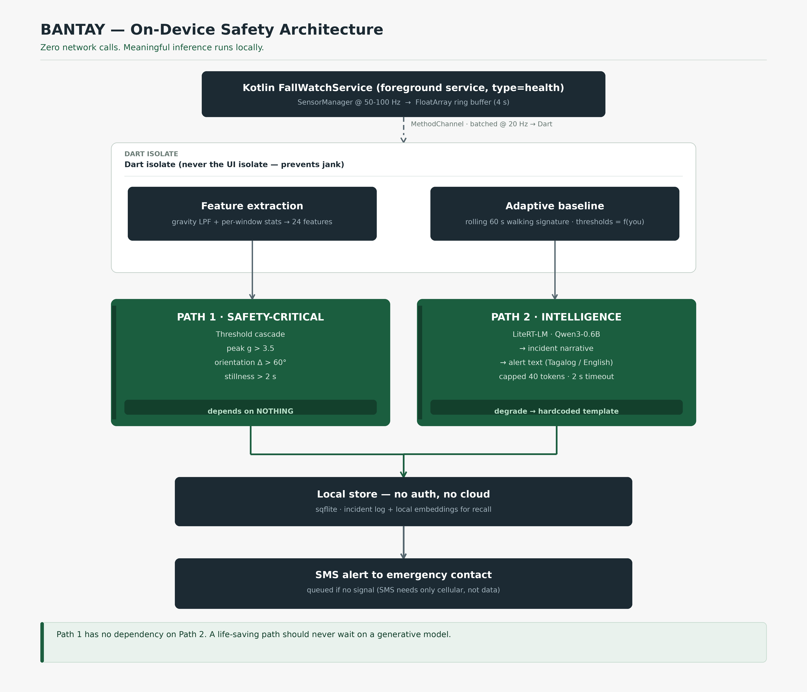

# BANTAY — Build Spec

> **Tagline:** the safety net that never phones home.

**Hackathon:** AppBuildersPH Hackathon 2026 — Local AI track
**Target user:** a senior living alone in a rural barangay
**Team:** 3–4, strong backend/web, some ML, design + pitch. No dedicated mobile dev.
**Timeline:** ~24 hours
**Hardware:** mid-range Android phone, CPU only

## Diagrams

- [System architecture](assets/bantay-architecture.jpg)
- [UI flow](assets/bantay-ui-flow.jpg)

## Documents

| Doc | Contents |
|-----|----------|
| [SPEC.md](SPEC.md) | Problem, build schedule, detector, LLM, risks — what the team executes |
| [architecture.md](architecture.md) | Modules, threading, state machine, data model, failure modes |
| [ui-flow.md](ui-flow.md) | Six screens, navigation, demo moments |

---

## 1. Problem

Maria, 74, lives alone in a rural barangay in Bulacan. Cell signal is
intermittent. Her daughter in Manila is 60 minutes away. If Maria falls and
nobody knows, the golden hour is gone.

Falls are a leading cause of injury death for older adults. The detection
problem is not "does the phone sense an impact" — every phone does that. The
problem is that nobody is watching, and the alert has to arrive in seconds.

## 2. Why local AI is fundamental (not a preference)

Continuous accelerometer streaming to a cloud API is financially unshippable
per user, and an alert that arrives 1.5 seconds late is a **failed alert**, not
a slow one. Motion data is health data — under the Data Privacy Act, streaming
it is a legal liability. And when you actually need it, the cloud does not
exist.

Three-sentence judge answer, rehearsed:

> Continuous sensor streaming to a cloud API is financially unshippable per
> user, and an alert that arrives 1.5 seconds late is a *failed* alert, not a
> slow one. Motion data is health data. And when you actually need it, the
> cloud doesn't exist. So we don't call the cloud. Ever.

---

## 3. Architecture



Two independent paths, on purpose.

**Path 1 — safety-critical.** Threshold cascade → alarm, countdown, haptic.
Target < 100ms. Depends on **nothing**.

**Path 2 — intelligence.** LiteRT-LM (Qwen3-0.6B) → incident narrative →
alert text. Capped 40 tokens, 2s timeout. Degrades to a hardcoded template.

> A life-saving path should never wait on a generative model.

### Data flow

```
Kotlin FallWatchService (foreground, type=health)
  SensorManager @ 50-100Hz -> FloatArray ring buffer (4s)
        |  MethodChannel, batched @ 20Hz -> Dart
        v
Dart isolate (never the UI isolate)
  Feature extraction (gravity LPF + per-window stats -> 24 features)
  Adaptive baseline (rolling 60s walking signature, thresholds = f(you))
        |
        +--> PATH 1  threshold cascade  -> alarm immediately, < 100ms
        |
        +--> PATH 2  LiteRT-LM Qwen3-0.6B -> narrative + alert text
                          |
                          v
                 Local store (sqflite, no auth, no cloud)
                 incident log + local embeddings for recall
                          |
                          v
                 SMS alert to emergency contact (queued if no signal)
```

**Note:** SMS needs only a cellular signal, not data. In a typhoon, data is
often dead while SMS still routes. That's the graceful-degradation story.

**Full detail — module map, threading model, state machine, data schema,
permission rationale, failure modes:** see [architecture.md](architecture.md).

---

## 4. UI flow (demo scope only)

No auth, no accounts, six screens.


| # | Screen | Purpose |
|---|--------|---------|
| 1 | Setup | Pick contact, calibrate baseline, arm |
| 2 | Guardian Active | "watching for you", live accel strip, manual SOS |
| 3 | Incident | Countdown, what we detected, I'm OK / Send help |
| 4 | Alert Sent | Confirmation + the exact message sent |
| 5 | History | Local incident log + "what happened last Tuesday?" |
| 6 | Eval | Precision / recall / F1 from the training harness |

### Three demo moments

1. **Screen 3 countdown → "I'M OK"** — the fear is real and dischargeable.
2. **Airplane mode on screen 2** — nothing changes. Say nothing. Let them
   notice.
3. **Screen 5 "what happened last Tuesday?"** — conversational recall over a
   private log, in a dead zone.

---

## 5. Dependencies

```yaml
# pubspec.yaml
flutter_background_service: ^5.0.0   # also set foregroundServiceTypes in manifest
sensors_plus: ^6.0.0                  # expect 20-50Hz, NOT the 100Hz requested
flutter_edge_ai_litertlm: ^0.2.0      # LiteRT-LM over dart:ffi, no JVM
sqflite: ^2.3.0
path_provider: ^2.1.0
fl_chart: ^0.68.0                     # live accel strip + eval bars
geolocator: ^13.0.0                   # coordinates only, no reverse geocode
```

```gradle
// app/build.gradle.kts
implementation("com.google.ai.edge.litertlm:litertlm-android:latest.release")
```

### AndroidManifest.xml — the most important 15 lines in the project

```xml
<uses-permission android:name="android.permission.FOREGROUND_SERVICE" />
<uses-permission android:name="android.permission.FOREGROUND_SERVICE_HEALTH" />
<uses-permission android:name="android.permission.HIGH_SAMPLING_RATE_SENSORS" />
<uses-permission android:name="android.permission.POST_NOTIFICATIONS" />
<uses-permission android:name="android.permission.WAKE_LOCK" />
<uses-permission android:name="android.permission.SEND_SMS" />
<uses-permission android:name="android.permission.ACCESS_COARSE_LOCATION" />

<service android:name=".FallWatchService"
        android:foregroundServiceType="health"
        android:exported="false" />
```

> **Do NOT add `BODY_SENSORS`.** It's a while-in-use permission. Once
> backgrounded, the health FGS throws `SecurityException`, and the workaround
> (`BODY_SENSORS_BACKGROUND`) requires an installer allowlist a hackathon
> cannot obtain. `HIGH_SAMPLING_RATE_SENSORS` is install-time, no dialog, no
> allowlist. This is the single highest-leverage permission decision in the
> build.

---

## 6. Detector

**Sampling:** 50 Hz (Android won't honour 100 Hz requests).
**Window:** 2s = 100 samples, 50% overlap.

**Features (24):** per-axis (acc x/y/z, gyro x/y/z) — mean, std, min, max; plus
vector magnitude peak, gravity-vs-orientation delta, jerk peak, stillness
duration.

### Path 1 — threshold cascade (guaranteed, ship first)

1. magnitude peak > 3.5 g
2. AND within 500 ms, low-passed gravity estimate deviates > 60° from
   pre-impact orientation
3. AND followed by ≥ 2 s stillness below 0.15 g variance
4. AND **not** within 8 s of a user-initiated test/calibration flag

### Path 1b — trained MLP (hour-gated)

24 → 16 ReLU → 2. ~434 params, weights as a JSON asset, forward pass in pure
Dart.

Budget check: ~434 MACs × 100 windows/sec = **43,400 MAC/s ≈ 0.002% of one
core**. No TFLite, no ONNX, no Gradle changes, no NDK, no ProGuard rules.

**Non-negotiable:** run on a background isolate. On the UI isolate you will jank
at 50 Hz.

### Training data (~2 hours, no downloads needed)

- **Positives:** synthetic phone drops. A drop is far simpler physics than a
  human fall — free fall (0g) → impact spike (randomize 3–12g) → tumble → rest
  at 1g on one axis. ~40 lines of Python, thousands of samples in minutes, every
  one physically valid.
- **Negatives:** UCI HAR ADL windows. Cite it. Note the bundled README says
  "no commercial use" while the UCI page says CC BY 4.0 — attribute explicitly.

**Skip entirely:** KFall (application form, identity verification — days of
friction), UP-Fall (812 GB), FARSEEING (no third-party transfer).

---

## 7. LLM

**Model:** `litert-community/Qwen3-0.6B` (~450 MB). Chosen over
Gemma-3-270M for multilingual coverage — that's what buys the Tagalog alert.

**Runtime:** LiteRT-LM, not MediaPipe. MediaPipe's LLM API is maintenance-only;
Google steers you to LiteRT-LM. Also one Gradle line, CPU backend, documented
working on the emulator.

### The prompt

A 0.6B model will **not** write a freeform emergency message reliably. The
documented failure mode is a team burning a sprint on four prompt rewrites. So:
**filled-in template, never a blank page.**

```
You are a safety alert writer. Rewrite the message in {language} using ONLY these facts.
Keep it under 40 words. Calm, factual, no reassurance.

FACTS:
- Impact: {impact_g}g at {time}
- Before impact: {pre_context}          # walking / still / running / unknown
- After impact: {motion_summary}        # moved immediately / no movement for {n}s
- Location: {location_desc}             # coordinates only, no reverse geocode
- Contact: {contact_name}

MESSAGE:
```

### Hard rules

- `maxTokens: 40`
- 2-second wall-clock timeout
- On timeout, failure, or empty output → send the hardcoded bilingual template,
  unedited
- The app must be fully functional with the LLM absent. That's a feature, and
  it's what makes the demo safe.

---

## 8. Assignments

| Owner | Role | Owns |
|-------|------|------|
| A | Backend lead | Flutter shell, ring buffer, features, UI screens 2/3/5, integration |
| B | Backend / native | `FallWatchService` Kotlin, manifest, permissions, MethodChannel, SMS |
| C | ML/DS | Synthetic generator, MLP training, eval harness, thresholds, screen 6 |
| D | Design + pitch | UI polish, demo script, deck, device prep, backup video |

### Gates

**Hour 2.** If LiteRT-LM didn't work → switch to `net.ladenthin:llama-android`
**immediately**, not later. If that failed → template-only.

**Hour 16.** If Path 2 isn't generating acceptable text → ship template-only and
present Path 1 as the product. Do not debug prompts on demo eve.

---

## 9. Build schedule

### Phase 0 — hours 0–2, de-risk. Do not skip.

Four spikes, in parallel, all must pass:

1. Flutter builds and runs on the actual demo phone
2. `sensors_plus` delivers usable accelerometer data at real-world rate
3. LiteRT-LM loads Qwen3-0.6B on that phone and generates tokens
4. Model file sideloaded via `adb push` — never trust conference wifi with 450MB

### Phase 1 — hours 2–8, foundation (parallel)
Per owner, per §8.

### Phase 2 — hours 8–16, detector then intelligence
Threshold cascade first. Then swap in the MLP as primary, cascade as backstop.
Ship whichever validates better. Then LiteRT-LM integration and prompt
engineering. Then ship the **eval screen** — live confusion matrix from the
training harness. Judges trust numbers on screen.

### Phase 3 — hours 16–21, demo hardening
Device testing, airplane-mode verification, Tagalog path, battery/thermal,
backup laptop build.

### Phase 4 — hours 21–24, buffer
Reserve it. It always gets eaten.

---

## 10. Risks

| Risk | Sev | Mitigation |
|------|-----|------------|
| Phone is Android < 8 or 32-bit | **Blocker** | Triage today (§11). Source a device if needed |
| LiteRT-LM won't load on device | High | Spiked hour 2 → llama.cpp AAR → template-only, all pre-decided |
| LLM outputs garbage on stage | High | Template-fed, 40-tok cap, hardcoded fallback, 2s timeout |
| FGS type crash on Android 15 | Med | Set type in **both** manifest and `AndroidConfiguration`, or write the service in Kotlin |
| Battery optimization kills the service | Med | Demo screen-on and foregrounded. Background is a stretch, not a dependency |
| Judge drops your only phone | Med | Lanyard, spare device, backup laptop build, backup video |
| 450MB download fails at venue | Med | `adb push` sideload, tested in Phase 0 |
| Qwen Tagalog is shaky | Low | Alert text is template-driven; LLM only adjusts tone |
| "Is this a medical device?" | Med | State plainly: not a medical device, no diagnostic claim |

### Cut order

Trained MLP → gyroscope → screen-off operation → Tagalog output →
history/recall screen. **Last to cut: the LLM.**

---

## 11. Pre-event checklist

- [ ] Run the adb triage below and record results here
- [ ] Confirm USB debugging works
- [ ] Pre-create the Flutter project; get it building to a phone
- [ ] Download the LiteRT community model to a laptop, ready to `adb push`
- [ ] Provision emergency SMS credits (demo sends real SMS)
- [ ] Locate a spare phone + lanyard
- [ ] Build the laptop fallback build
- [ ] Rehearse the 3-minute pitch: problem → why-local (30s) → live demo →
      architecture → limits

### Device triage

Run before anything else:

```bash
adb shell getprop ro.build.version.release   # e.g. "10"
adb shell getprop ro.build.version.sdk        # e.g. "29"
adb shell getprop ro.product.cpu.abi         # arm64-v8a
```

| Result | Impact | Action |
|--------|--------|--------|
| Android 8.0+ (API 26+) | Proceed | `minSdk 26` |
| Android 7 or lower | **Stop** | LiteRT-LM needs ≥26 — find another device |
| 32-bit only | LiteRT-LM won't load | Need a 64-bit device |
| < 4GB RAM | Qwen3-0.6B will thrash | Gemma-3-270M or template-only |

---

## 12. Open questions

- **Qwen3-0.6B Tagalog quality is unverified.** We can't confirm it without the
  actual device. Phase 0 spike 3 partly covers it, but tone quality needs a
  real read.
- **Real fall recall vs. dropped-phone recall.** Our synthetic positives model
  phone drops, not human falls. Published threshold algorithms get ~57%
  sensitivity on real falls — honest number, fires reliably on a dropped phone,
  which is what a stage demo needs. Don't overclaim in the pitch.
- **`flutter_edge_ai_litertlm` maturity.** LiteRT-LM over `dart:ffi` is
  documented, but a thin wrapper. Kotlin is the documented path if the Dart
  binding misbehaves.

## 13. Provenance

Built during the hackathon. Disclosure for submission:

- Models: `litert-community/Qwen3-0.6B` (Google LiteRT community), UCI HAR
  dataset (CC BY 4.0, see §6 for the license conflict note)
- Frameworks: Flutter, LiteRT-LM, `sensors_plus`, `sqflite`, `fl_chart`
- No cloud AI APIs in the critical path. Zero network calls in the demo flow.
- AI-assisted development used for scaffolding. Diagrams rendered with
  Pillow.

---

## 14. Session record — ideation and decisions

Append-only log of what was decided and what was rejected.

### Date: 2026-10-09 — Ideation, architecture, spec

**Status at end of session:** design and documentation complete. No
implementation started. No `pubspec.yaml`, no `AndroidManifest.xml`, no
`FallWatchService`. Everything below is a plan.

### Product decisions

| Decision | Chosen | Rejected | Why |
|----------|--------|----------|-----|
| Lane | Always-on guardian | Offline field copilot; on-device personalization as the headline; local document/OCR AI | Only lane where "local or nothing" is structural rather than stylistic |
| Framing | Safety net that never phones home | "Fall detector app" | The latter reads as a commodity sensor app; the former carries the architectural argument |
| Target user | Senior living alone in a rural barangay | Solo riders/field workers; children + working parents; everyone | Most specific, highest stakes, makes the no-signal argument land. Broad "everyone" framing risks the 25% "clear target user" criterion |
| Personalization scope | Adaptive thresholds from a rolling gait signature | On-device fine-tuning of the LLM | Same judge-facing argument, buildable in 24h. Fine-tuning is a different hackathon |
| Platform | Flutter + minimal Kotlin | React Native/Expo; native Kotlin; desktop | Team is web-skilled with no mobile dev. Flutter ramps in ~1hr; latency-critical sensor work needs Kotlin service anyway |

### Technical decisions

| Decision | Chosen | Rejected | Why |
|----------|--------|----------|-----|
| LLM runtime | LiteRT-LM, CPU backend | MediaPipe `tasks-genai`; llama.cpp AAR; ONNX Runtime; MLC; ExecuTorch | MediaPipe LLM API is **maintenance-only**; Google steers to LiteRT-LM. Also one Gradle line and a documented CPU path. MLC can't run on an emulator and has first-inference hangs of 20-50s |
| LLM model | `Qwen3-0.6B` (~450MB) | Gemma-3-270M; Gemma-3-1B; Qwen larger | Multilingual coverage is what buys the Tagalog alert. Smallest viable |
| Detector v1 | Threshold cascade | Trained MLP first | Cascade works immediately with zero training risk. MLP is hour-gated, never a prerequisite |
| Detector ML | Pure Dart, weights as JSON | TFLite / ONNX Runtime | 434 MACs at 100Hz is 0.002% of one core. A native ML dependency buys nothing and adds Gradle/NDK failure modes |
| Positives | Synthetic phone drops | KFall, UP-Fall, FARSEEING | KFall needs an application form and identity verification (days). UP-Fall is 812GB. FARSEEING forbids third-party transfer. A phone drop is ~40 lines of parametric Python |
| Negatives | UCI HAR ADL | — | Fastest download. Shape the problem as one-class: learn normal, flag the rest |
| Sensor permission | `HIGH_SAMPLING_RATE_SENSORS` (manifest) | `BODY_SENSORS` | Install-time, no dialog, no allowlist. `BODY_SENSORS` is while-in-use and dies on backgrounding; the workaround needs an allowlist a hackathon can't get |
| Background ops | Demo screen-on, foregrounded | Full screen-off FGS operation | Biggest time sink, least impressive on stage. FGS is a bonus, never a demo dependency |
| Alert channel | SMS outbox | Push; email; app-to-app | SMS needs only cellular, not data. In a typhoon, data is often dead while SMS still routes |
| Geocoding | Coordinates only | Reverse geocode | Reverse geocoding is a network call. Would violate the zero-calls claim |
| Failover | `net.ladenthin:llama-android` | Nothing | Runs x86_64, so it also works on an emulator. Decided at hour 2, not hour 20 |

### Rejected strategic framing

Lane C ("it learns you, privately") was folded into Lane A as the adaptive
baseline rather than built standalone. Its argument was the sharpest available,
but on-device fine-tuning of a language model is not a 24-hour build. Folding
it in preserves the argument and drops only the unbuildable part.

### Docs produced this session

| File | Contents |
|------|----------|
| `SPEC.md` | This document — problem, schedule, detector, LLM, risks |
| `architecture.md` | Modules, threading, state machine, data model, failure modes |
| `ui-flow.md` | Six screens, navigation, demo moments |
| `assets/bantay-architecture.jpg` | System architecture diagram (4800×4120) |
| `assets/bantay-ui-flow.jpg` | UI flow diagram (7380×3240) |

### Blocking item outstanding

The adb device triage in §11 has not been run. Android version, ABI, and RAM
decide whether this stack holds at all. Android < 8 or 32-bit blocks LiteRT-LM
outright. This is the next action, not a documentation task.

### Compliance note for submission

AI-assisted development was used for scaffolding and research. Disclose per
the hackathon FAQ. Diagrams rendered locally with Pillow. No cloud AI API is in
the product's critical path; the demo runs with the radio off.
