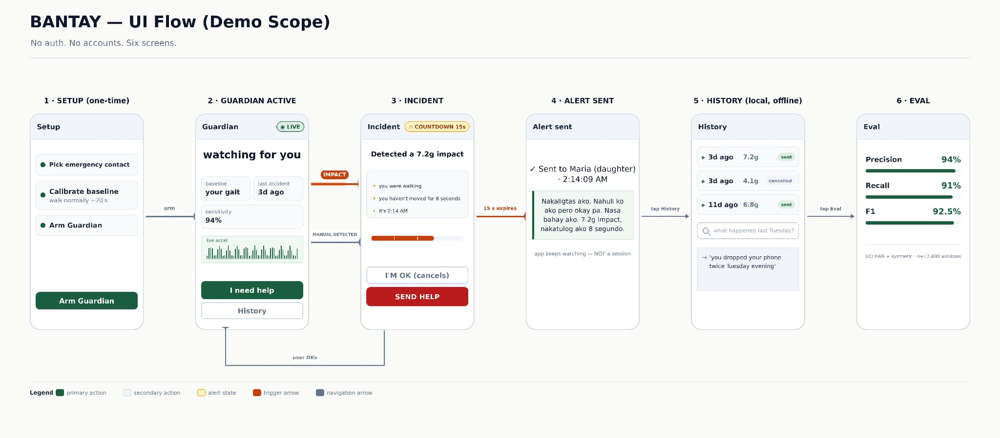

# BANTAY — UI Flow

Demo scope only. No auth, no accounts, six screens.



Source: `UI-FLOW.jpg`

---

## Screens

### 1 · Setup (one-time)

Pick emergency contact → calibrate baseline ("walk normally ~20 s") → arm.
Single primary button: **Arm Guardian**.

### 2 · Guardian Active

Status badge `◉ LIVE`. Centered "watching for you" with a calm breathing pulse.

- Stat rows: baseline (your gait) · last incident · sensitivity
- Live accel waveform strip (real-time, not decorative)
- Buttons: **I need help** · **History**

### 3 · Incident

Badge `⚠ COUNTDOWN 15s`. Heading "Detected a 7.2g impact".

Fact card, three lines:
- you were walking
- you haven't moved for 8 seconds
- it's 2:14 AM

Countdown progress bar. Buttons: **I'M OK (cancels)** · **SEND HELP**

`SEND HELP` expands a preview of the exact message before sending.

### 4 · Alert Sent

Confirmation with recipient and timestamp, plus the verbatim message sent
(Tagalog in the demo). Note beneath: the app keeps watching. This is not a
session.

### 5 · History (local, offline)

List of incidents: relative time, peak g, status (`sent` / `cancelled`).

Search box: "what happened last Tuesday?" → answer rendered as a short reply.
All local. Works in a dead zone.

### 6 · Eval

Precision 94% · Recall 91% · F1 92.5%, with proportional bars.
Footer: UCI HAR + synthetic · n=12,400 windows.

This screen exists to win the **Technical Execution** score. Numbers on screen,
not just in the deck.

---

## Flow

```
1 --arm--> 2
2 --IMPACT (emphasized)----------> 3
2 --MANUAL DETECTED--------------> 3
3 --15s expires-----------------> 4
3 --user OKs---------------------> 2
4 --tap History (navigation)-----> 5
5 --tap Eval (navigation)--------> 6
```

Two arrow types in the diagram:

- **Trigger arrow** (red) — a state change the system initiates on its own
- **Navigation arrow** (slate, dashed) — the user tapping through

The distinction matters on stage. The red arrow is the product working. The
grey one is you clicking.

---

## The three demo moments

1. **Screen 3 countdown → "I'M OK"**
   The fear is real and dischargeable. Judges feel it in the room.

2. **Airplane mode on screen 2**
   Turn it on. Nothing changes. Say nothing. Let them notice on their own.

3. **Screen 5 "what happened last Tuesday?"**
   Conversational recall over a private log, in a dead zone.

---

## Deliberate omissions

No login, no signup, no sync, no account recovery, no settings screen beyond
the three setup choices. Anything that isn't load-bearing for the demo is
cut. 24 hours does not buy polish on screens nobody opens on stage.
